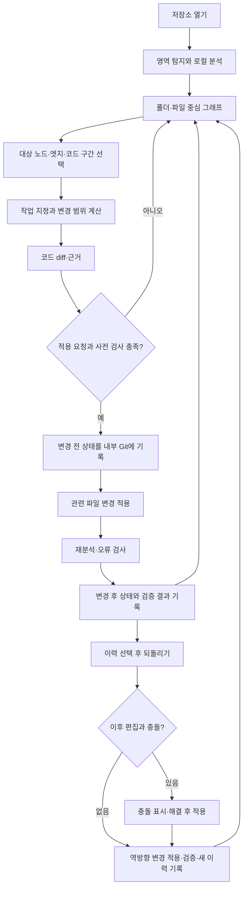
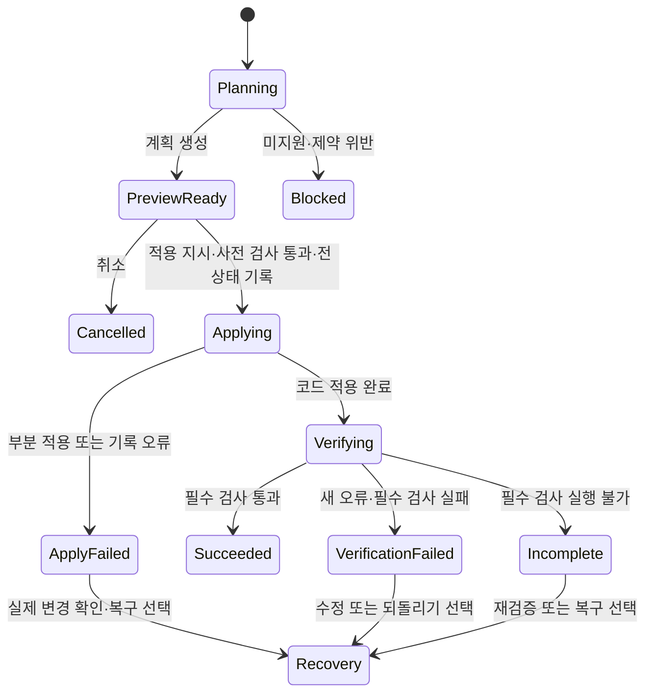

# Skein 설계

Skein은 코드 구조와 참조 관계를 사람이 탐색하고, 명시한 구조 기준 아래에서 코드를 재구성·검증하는 VS Code 확장이다. 이 문서는 설계 결정과 그 이유, 확인된 사실만 적는다. 실행 방법은 README에 있다.

## 1. 제품 목표와 범위

에이전트가 만든 코드를 충분히 이해하지 못한 채 국소 수정을 반복하면 중복 구현, 책임 혼재, 잘못된 기능 배치, 과도한 추상화, 의존성 문제가 쌓인다. 우선순위는 **리팩토링 → 온보딩 → 변경 후 검토 → 변경 전 이해**이고, 시각화는 구조를 판단해 실제 변경으로 잇는 작업 인터페이스다.

- 형태는 VS Code 확장이다. 검증 언어는 Dart와 TypeScript이며 다른 언어를 추가할 수 있게 어댑터로 나눈다.
- 폴더·파일·클래스·함수와 호출·참조를 탐색해 코드 위치로 이동한다.
- 이동·이름 변경·함수 추출·인라인을 제공하고 언어·대상별 지원 조건을 표시한다.
- 다섯 진단 영역(책임 집중·중복 구현·기능 배치·과도한 추상화·의존성 문제)을 제공한다.
- 분석은 로컬에서 수행하며 자동 LLM 호출은 없다.
- 사람과 에이전트는 같은 화면 상태와 변경 경로를 쓴다.
- 설정·상태는 로컬 단일 정형 파일, 변경 이력은 별도 내부 Git 저장소에 둔다.

**범위 밖**: 모의 입력·동적 실행 추적, 미래 구조 설계 전용 편집 모드, 여러 리팩토링의 일괄 예약, 이력의 브랜치·병합 UI와 원격 동기화, 확장 안의 AI 채팅과 자체 에이전트 실행기, 모든 언어에서 같은 수준의 기능 보장.

## 2. 대표 작업과 전체 흐름

사용자는 저장소를 열어 구조를 확인하고, 진단이나 직접 탐색으로 변경 대상을 고른다. 도구가 변경 범위와 근거를 계산해 계획으로 보여 주고, 편집기 명령은 diff 탭 없이 확인 모달에 파일별 변경 줄 수를 보인다. 적용 후 바뀐 파일(최대 5개)을 Skein 그래프 탭이 없는 에디터 그룹에 일반 탭으로 연다. 적용 후에는 재분석·검사를 실행하고 결과를 이력에 남긴다.



구조 프로필이 없으면 현재 구조를 탐색할 수 있다. 목표 구조 기준은 영역별로 사용자가 확정해 적용하며, 프로필 선택 자체가 코드를 바꾸지는 않는다.

## 3. 화면 구성과 탐색

### 3.1 진입점과 화면 배치

Live Call Graph의 Cytoscape 화면을 중심으로 통합한다. 파일 그래프·심벌 뷰·아키텍처 뷰는 같은 화면에서 표시 수준을 전환하는 모드(`file`·`list`·`symbol`·`callgraph`·`architecture`)이며, 하단 패널과 에디터 탭은 하나의 분석 세션과 선택·펼침 상태를 공유한다.

- 에디터 제목 영역의 그래프 아이콘으로 일반 에디터 탭을 연다. 코드와 나란히 분할할 수 있다.
- 처음에는 폴더·파일 묶음으로 보고, 펼치면 함수·클래스 등 심벌이 나타난다.
- 표시량을 제한하면 숨긴 수와 실제 분석 범위를 구분해 표시한다. 호출 그래프는 최대 500개 심벌을 가까운 hop부터 보여 준다.
- 줌·팬은 화면별로 두고 노드 위치·선택·펼침만 공유한다. 캔버스 크기가 다른 패널과 에디터 탭이 줌·팬을 섞으면 서로 반대로 움직이기 때문이다.

### 3.2 원형 노드·조작·상세

심벌은 이름 없는 원으로 그리고 폴더·파일 묶음에는 이름을 표시한다. 심벌 이름은 상세·검색·접근성 정보에 유지한다.

| 조작 | 동작 |
|---|---|
| 심벌 원 클릭 | 선택·관계 강조·오른쪽 상세 표시. 자동 코드 이동과 재중심화는 하지 않음 |
| 코드 열기 버튼·더블클릭 | 선언 위치로 이동 |
| 엣지 클릭 | 관계 근거와 호출·참조 위치 목록 표시 |
| 원 드래그 | 화면 위치만 변경, 이웃이 따라옴(아래). 코드 이동과 구분 |
| 파일 그래프 노드 | 클릭은 선택과 파일 열기, 더블클릭이나 "View symbols" 버튼은 파일 안으로 진입 |
| 참조 복사 | 프로젝트·노드 ID·경로·심벌·위치·분석 버전 |

**배치**: 호출 그래프는 물리 기반 시뮬레이션으로 배치한다(`physicsLayout.ts`). 잎 노드가 몸체이고 호출 간선은 스프링, 모든 쌍은 반발하며, 같은 파일의 노드는 파일 묶음 중심으로, 폴더 묶음 안의 노드는 폴더 중심으로 끌린다. 같은 부모의 형제 묶음은 서로 밀어낸다. 복합 노드의 경계는 Cytoscape가 자식 위치에서 계산하므로 묶음 자체는 시뮬레이션하지 않는다. `cola`·`d3-force`는 복합 노드 포함 관계를 다루지 못해 자체 구현했고 새 의존성은 없다. 시뮬레이션은 결정적이다(난수 없음).

- 첫 렌더·새 루트·Re-layout은 시드 배치 후 정착시킨다. 500개 노드 정착에 약 100ms가 든다.
- 저장된 배치(`.skein/state.json`)는 그대로 복원하며 저장·필터·부분 펼침에서 전체를 다시 배치하지 않는다. 새 노드는 이웃 옆에 놓는다.
- 잎 노드를 드래그하면 그 노드를 고정하고 나머지가 반응해 다시 정착한다. 클릭만으로는 재배치하지 않는다. 파일·폴더 묶음 드래그는 Cytoscape 기본 동작이다.

### 3.3 선택적 접기

자동 접기는 기본적으로 꺼져 있다. 옵션을 켜면 단일 호출자의 내부 구현을 그 호출자 안에 접어 표시한다. 공개 심벌·프레임워크 진입점·참조가 불완전한 심벌은 제외하고, 접힌 함수의 외부 연결은 집계해 표시한다. 단일 호출자는 불필요한 추상화의 확정 판정이 아니다.

## 4. 분석·증분 갱신

### 4.1 분석 단계

패키지·프로젝트 영역 탐지 → 의존성·빌드·생성 코드 제외 → 언어별 구문·심벌 추출 → 이름·타입·참조 해석 → 프레임워크 보완 → 공통 그래프와 근거 정규화 → 프로필 검사·진단. 구문 분석, 의미 해석, 프레임워크 보완은 서로 다른 책임이다. Tree-sitter 추출만으로 참조가 모두 해석된다고 가정하지 않고, 이름이 같다는 이유만으로 연결을 확정하지 않는다.

### 4.2 분석 범위

저장소 전체를 분석하되 영역 경계를 탐지한다. 빌드 결과·의존성·생성 코드는 기본 제외하며 제외 설정은 바꿀 수 있다. 제외로 참조 확인이 제한되면 그 한계를 기록하고, "참조를 찾지 못함"과 "다른 참조가 없음을 확인함"을 구분한다.

### 4.3 갱신

- 파일 저장 시 변경 파일과 영향받는 관계·진단을 증분 갱신한다. 도구의 변경 적용 직후에도 즉시 재분석한다.
- 저장하지 않은 편집이 있으면 그래프가 저장된 코드 기준임을 표시한다.
- 파일 추가·삭제·이동, 프로젝트 설정·의존성·분석기 버전 변경은 무효화 조건이다. 삭제된 파일은 색인에서 제거하고, 생성된 파일은 색인하며 이동한 심벌을 따라간다.
- 재분석 중에는 결과의 버전과 최신 여부를 구분하며 불완전한 결과를 최신 확정 결과로 대체하지 않는다.

## 5. 데이터 모델과 로컬 저장

### 5.1 공통 모델

| 엔터티 | 핵심 정보 |
|---|---|
| 프로젝트·영역 | 저장소 식별, 영역 루트, 언어·프로젝트 설정, 프로필 |
| 코드 노드 | 식별자, 언어, 심벌 종류, 이름, 파일·선언 범위, 소속 |
| 관계 | 호출·참조·상속·구현 등 종류, 출발·도착, 발생 위치 목록 |
| 분석 근거 | 분석기·버전, 구문/의미/프레임워크 출처, 확인·추정·미해결 상태 |
| 분석 범위 | 검사한 영역, 제외 경로, 실패·미지원 항목, 최신성 |
| 진단 | 규칙·버전, 대상과 근거, 확정 위반/검토 후보, 상태 |
| 프로필·예외 | 책임과 경계, 허용 의존성, 승인된 예외의 이유·범위·만료 |
| 변경 계획 | 작업, 기준 코드 지문, 대상, 편집안, 검사 결과 |
| 작업 이력 | 내부 Git 기록 참조, 전후 경로, 적용·검증 상태, 원작업과 되돌리기 관계 |

소속 관계와 참조 관계를 분리하고, 같은 노드를 어떻게 묶어도 원래 식별을 유지한다. 오래된 ID는 다른 심벌로 대체하지 않는다. 공통 모델은 기존 분석기 앞의 변환 계층(`src/analyzer/model`)이며 서로 다른 분석기의 주장을 조용히 덮어쓰지 않는다. Dart 호출은 구문·이름 기반이라 동명 심벌이 여럿이면 확정하지 않는다.

### 5.2 로컬 파일 배치

```text
<workspace>/.skein/
  .gitignore       "*" — 폴더 전체를 Git 추적에서 제외
  state.json       뷰 상태(스키마 2). 확장만 쓴다
  commands/        MCP가 남기는 <id>.request.json, 확장이 답하는 <id>.result.json
  history/         내부 Git 저장소(repo.git), index.json, tasks/<planId>.json
  cache/           분석 캐시(재생성 가능)
~/.skein/stats/    세션 통계
```

`state.json`은 확장이 단독으로 쓰고 MCP는 읽기만 한다. MCP는 `commands/`에 유일 id의 요청을 임시 파일 작성 후 rename으로 원자적으로 쓰고 결과를 기다린다. 두 프로세스가 같은 파일을 덮어쓰지 않는다.

- 상태: 뷰 모드, 현재 파일, 뷰별 선택, 호출 그래프 루트·깊이·배치(노드 좌표·줌·팬), 숨긴 필터, 펼침, `graphVersion`, `lastUserActionAt`, `surface`(제한된 노드 ID·펼침·검색 결과·필터 허용 값·분석 요약·진단 참조), `workspaceRoots`.
- 창별 스냅샷(`windows`)을 잠금 아래 읽기-수정-쓰기로 병합해 같은 폴더를 여러 창에서 열어도 서로 지우지 않는다. 멀티루트는 선택한 영역(`Skein: Set Workspace Folder`)의 `state.json`을 쓰고, 영역 전환·창 종료 때 그 창의 스냅샷을 지운다.
- `graphVersion`은 그래프가 새로 그려질 때와 파일 변경·재분석·인덱스 재구축 때 증가하며 재시작 후에도 유지된다. `.skein` 안의 쓰기는 감시에서 제외한다(상태 게시가 버전을 올리는 되먹임을 막기 위함). MCP 명령에 읽은 버전을 지정하면 다르면 `stale-graph-version`으로 거부된다.
- 사용자가 조작하면 `lastUserActionAt`이 갱신되고, 그보다 먼저 대기한 명령은 `user-action-superseded`로 거부된다. 드래그·줌·노드 이동 중에는 렌더러가 상호작용 상태를 게시하며(마지막 이벤트 후 250ms 해제, 웹뷰 무응답 시 3초 만료) 그동안의 명령도 거부된다. 프로그램이 일으킨 뷰포트 이동은 사용자 조작으로 표시하지 않는다.
- 확장이 응답하지 않으면 MCP 도구는 `extension-not-responding`으로 실패한다.
- 재분석은 사용자가 확정한 설정·프로필·예외를 보존한다.

## 6. 구조 프로필·문서 책임

### 6.1 영역별 구조 프로필

프로필은 책임 배치, 경로 규칙, 허용 의존 방향을 정의한다. 저장소 전체에 하나의 구조를 강제하지 않고 영역별 프로필과 영역 사이의 연결 규칙을 둔다.

- `skein.architecture.json`에 `elements`(파일 집합)·`rules`(허용 의존)·`roles`·`profiles`(레이어 순서)·`areas`(영역별 프로필)·`exceptions`(이유·만료가 있는 명시적 허용)·`diagnostics`(임계값)를 둔다. 영역마다 `profile:<area>` 규칙이 생기고, 레이어 역방향 import는 확정 위반이다. 프로필 `strict`에서는 레이어 밖 import도 위반이다.
- 기존 위반은 기준선(`baseline`)에 기록한다. 기준선 v2는 진단별 안정 ID와 허용값을 기록하고, 값이 커지면 `worsened`, 같거나 작으면 `accepted`, 사라지면 `resolved`로 판정한다. v1 파일은 그대로 동작한다.
- 새로 생기거나 악화된 위반은 변경 적용을 차단한다. 예외는 이유·범위를 지정해 기록하며 만료되면 다시 위반이 된다.
- 불확실한 관계는 확정 위반으로 판정하지 않는다.

### 6.2 문서별 단일 책임

| 위치 | 원본으로 관리할 내용 |
|---|---|
| README.md | 제품 소개, 준비·설정·실행·검증 |
| DESIGN.md | 설계 결정, 책임·경계, 기술 선택과 이유 |
| `skein.architecture.json` | 정확한 허용 의존성·프로필·예외 |
| 내부 Git | 변경 전후 파일 상태와 작업 이력 |

같은 규칙을 여러 문서에 복사해 따로 관리하지 않는다.

## 7. 구조 진단

다섯 영역을 제공하고 기계적으로 확인한 위반(`confirmed`)과 검토 후보(`candidate`)를 분리한다. 선언한 규칙에서 나온 결과만 `confirmed`이며 후보는 변경을 차단하지 않는다.

| 영역 | 탐지 근거 | 해석의 한계 |
|---|---|---|
| 책임 집중 | 크기·imports·importers와 임계값 | 여러 업무 책임인지는 의미 판단 필요 |
| 중복 구현 | 정규화한 토큰 shingle의 파일 간 유사성 | 다른 형태의 같은 기능은 놓침. 50개 넘는 파일이 공유하는 shingle은 보일러플레이트로 무시 |
| 기능 배치 | 프로필 경로·책임·의존성 규칙 | 의미적 기능 소속은 코드만으로 확정 불가 |
| 과도한 추상화 | 단일 위임 래퍼·단일 구현 인터페이스 | 의도된 경계나 확장점일 수 있음 |
| 의존성 문제 | 선언 규칙 위반(확정), 순환·과중 결합(후보) | 런타임 연결은 범위 밖 |

모든 결과는 규칙, 범위, 코드·관계 근거, 불확실성과 한계를 제공한다. 단일 종합 점수는 만들지 않으며 진단은 코드를 자동 수정하지 않는다. 참조를 복사해 외부 대화에서 의미 검토를 요청할 수 있고, 자동으로 코드를 LLM에 보내지 않는다. Architecture view 진단 패널과 MCP `skein_diagnose_structure`가 같은 revision의 결과를 낸다.

## 8. 리팩토링 계획·적용·검증

### 8.1 작업별 시작점

| 작업 | 시작점 | 범위 |
|---|---|---|
| 이동 | 함수·클래스 노드와 대상 파일/새 경로 | 대상과 규칙상 함께 이동할 내부 구현, 참조·import 수정 |
| 이름 변경 | 노드 | 언어 서비스가 해석한 선언·참조 |
| 함수 추출 | 편집기의 코드 구간 | 새 함수·인자·호출부 |
| 인라인 | 호출 엣지 또는 함수 노드 | 특정 호출 또는 모든 호출 |

### 8.2 변경 구현 방식

이름 변경은 언어 서비스(TypeScript 내장, Dart 확장)의 rename provider를 쓰고, 지원되지 않으면 명시적으로 거부한다. 제공자가 없어도 VS Code가 빈 편집을 돌려주므로 거부 메시지는 언어 확장 설치·활성화·작업공간 신뢰를 안내한다. 이동·추출·인라인은 `src/analyzer/change/refactor.ts`의 규칙 엔진이 VS Code 타입 없이 계산한다. 구현하지 못한 작업을 에이전트 호출로 대체하지 않는다. 에이전트가 만든 코드도 도구의 변경 작업으로 적용하려면 같은 계획·검사·이력 경로를 거친다.

### 8.3 이동 묶음 계산

이동 범위는 규칙 엔진이 계산한다.

1. 선택한 심벌의 의존 대상을 구한다.
2. 후보의 모든 사용처가 이동 집합 내부인지 확인한다.
3. 공개 API·진입점·접근 제한 등 제약을 검사한다.
4. 조건을 만족하는 내부 구현만 집합에 추가하고 더 이상 바뀌지 않을 때까지 반복한다.
5. 다른 곳에서도 쓰이는 helper와 공개 심벌은 원위치에 두고 import를 수정한다.
6. 이동으로 순환·이름 충돌이 생기는지 확인한다.

새 파일과 기존 파일 모두에 필요한 import를 만들고 참조 파일의 import 경로를 바꾼다. 대상 파일이 이미 이동할 이름을 원본에서 import하고 있으면 그 import를 제거한다. 원본에 남는 코드가 이동한 심벌을 계속 쓰면 import를 **문장 범위 기준**으로 마지막 import 뒤(없으면 파일 맨 위)에 넣는다. 진입점, Dart private helper, 이름 충돌, 순환 import, 해석되지 않은 import(경로 별칭 포함)는 사유와 함께 거부한다. 재수출 파일은 대상 경로로 갱신한다. 이동 대상 경로의 상대 경로는 심벌이 속한 워크스페이스 폴더 기준으로 해석한다.

**빈 원본 삭제**: 이동 뒤 원본에 import·주석만 남으면 같은 변경 안에서 삭제한다. 다음을 모두 만족할 때만 삭제하고 확신이 없으면 유지한다(사유는 분석 노트에 기록).
- 진입 파일(`index`·`main`)이 아니다.
- 설정·`package.json`·`tsconfig`·스크립트를 포함한 어떤 워크스페이스 파일도 그 모듈 이름을 따옴표·슬래시로 둘러싼 형태로 언급하지 않는다. 계획이 고치는 파일은 계획 적용 후 내용으로 판정한다.
- 텍스트 검색이 불가능하거나 실패했거나(5,000개 초과·5MB 초과 파일) 지원되지 않으면 유지한다.

삭제는 이력에 `deleted`로 기록되며 Undo가 복원한다. 변수를 조합해 만든 동적 import 경로는 감지하지 못한다.

추출은 감싸는 함수의 매개변수·지역 변수에서 인자를 만들고(TypeScript 지역 변수는 `any` 명시, 감싸는 함수의 매개변수는 타입 유지) 식·문장 선택을 구분한다. 선택 안에서 선언한 이름이 선택 뒤에서 쓰이거나 `this`, 동기 함수 안의 `await`는 거부한다. 인라인은 비공개·비async 단일 식 최상위 함수만 지원하며 호출 하나만 인라인하면 남은 호출이 있는 동안 선언을 유지한다.

### 8.4 적용 상태와 실패



한 번에 하나의 변경만 처리한다. 계획은 정확한 저장 내용과 코드 지문(SHA-256·존재·`graphVersion`)을 보관하고, 적용 직전에 지문을 확인해 달라졌으면 `stale-plan`으로 거부한다. 저장하지 않은 편집이 있으면 `unsaved-changes`로 거부한다.

적용 순서는 지문 재확인 → 저장되지 않은 편집 확인 → 구조 규칙 사전 검사 → before 스냅샷 → 적용 → after 스냅샷 → 진단 비교다. before 기록이나 적용이 실패하면 코드를 진행하지 않는다.

- **디스크 직접 쓰기**: 편집기 저장은 사용자의 저장 시 포매터가 계획한 내용을 바꿔 적용 후 비교가 어긋나므로, 적용은 파일에 직접 쓴다. 열린 탭은 다시 읽고 편집기 자체의 Ctrl+Z 스택에는 남지 않아 Skein의 되돌리기를 쓴다.
- **진단 비교**: 적용 후 파일을 열어 언어 서버에 알리고 최소 1.5초 기다린 뒤 진단이 안정될 때 판정한다. 디스크에 쓴 직후의 빈 진단은 판정이 아니다. 새 오류는 `verification-failed`로 기록하고 diff와 이력을 남기며 자동 롤백하지 않는다.
- **구조 가드**: 변경 파일에 이미 새 확정 위반이 있으면 적용을 `architecture-blocked`로 거부한다(예외가 있으면 허용). 가드가 변경 파일을 분석하지 못하면 통과가 아니라 `unavailable`이다. 적용 후 새로 생기거나 커진 위반은 `verification-failed`다. 규칙 파일이 없는 프로젝트는 가드를 건너뛴다.
- **Undo·다시 적용**: 기록된 상태를 복원할 뿐이므로 사전 차단 없이 사후 검증으로만 판정한다. 위반을 고치는 변경도 되돌릴 수 있어야 하기 때문이다.
- 프로세스 중단 시 `applying`·`verifying`으로 남은 작업은 다음 활성화에서 디스크와 대조해 `recovery`로 분류하며 자동 적용·자동 롤백은 없다(`interrupted-partial` 등).

## 9. 내부 Git 이력·되돌리기

### 9.1 범위와 격리

`.skein/history/repo.git`은 별도 `--git-dir`·`--work-tree`로 매 명령에 명시해 쓰며 사용자 저장소의 HEAD·인덱스·브랜치·훅과 분리된다. 원격이 없고 push하지 않으며, 계획이 건드린 파일만 기록한다. 이 저장소가 실행 중 사라지면 다음 적용에서 다시 만들어지고, 이전 이력 커밋은 사라져 그 항목은 되돌릴 수 없다.

### 9.2 기록

작업 ID·종류·요청 주체·시점, 전후 파일 내용·경로·생성/삭제, 계획·검증 상태, 되돌리기·다시 적용 대상과의 연결을 기록한다. 하나의 사용자 작업이 하나의 이력 항목이다. before 기록에 실패하면 코드 적용을 시작하지 않고, 적용 후 기록에 실패하면 완료로 표시하지 않는다.

### 9.3 되돌리기와 다시 적용

기록된 after·현재·before 세 상태를 `git merge-file` 3-way 병합해 이후 사용자의 편집을 보존한다. reset·checkout으로 덮어쓰지 않는다. 충돌 시 파일을 건드리지 않고 경로·충돌 수·첫 hunk를 반환한다. 생성·삭제·재생성도 복원한다. 되돌리기와 다시 적용도 검사와 새 이력 기록을 거친다. 이력은 선형이어서 가장 최근 항목만 되돌리기·다시 적용할 수 있다.

## 10. MCP와 에이전트 공동 조작

Codex 전용 화면·채팅을 두지 않고 공통 MCP에 상태·조회·조작·변경 명령을 노출한다. 사용자는 평소 에이전트 대화에서 작업한다.

### 10.1 기능 계약

- **화면**: `skein_get_view_state`(조회), `skein_control_view`(`select`·`focus`·`set_depth`·`open_file`·`set_filter`·`set_expand_all`·`search`·`set_expanded`·`set_architecture`·`set_view_mode`). `search`는 현재 화면에 로드된 노드가 대상이고 전체 검색은 `skein_graph_context`가 한다. 응답은 노드 좌표와 창 스냅샷을 빼고 `layout.positionCount`·창 요약만 담아 토큰 한도 안에 둔다. 명령은 렌더러가 상태를 반영하고 게시한 뒤에 응답하며, 없는 노드·숨겨진 노드·지원하지 않는 조작·무응답은 명시적으로 거부한다. `windowId`가 없으면 사용자가 마지막으로 조작한 창이 대상이다.
- **변경**: `skein_plan_change`(`kind`: `rename`·`move`·`extract`·`inline`)·`skein_apply_change`·`skein_get_change_plan`·`skein_list_change_history`·`skein_undo_change`·`skein_redo_change`.
- **진단**: `skein_diagnose_structure`(`kind`·`status`·`area`·`offset`/`limit`로 페이징, revision이 바뀌면 이전 offset은 거부).
- **그래프 조회**: `skein_graph_context`(검색·이웃·경로·영향·리팩토링·개요 모드, 토큰 예산과 커서).

**검색 순위**: `skein_graph_context` 검색은 어휘 점수로 후보를 정렬한 뒤, 상위 10개 후보의 파일을 시드로 파일 그래프(IMPORTS·CALLS·USES·IMPLEMENTS·INHERITS의 파일 간 간선)에서 Personalized PageRank를 구하고 어휘 순위와 구조 순위를 RRF(가중치 0.3)로 합친다. 후보를 더하거나 빼지 않고 순서만 바꾼다. 측정은 이 저장소의 라벨링한 질의 44개(`tests/benchmarks/graph-context-queries.json`, `npm run bench:graph-context`)로 했다.

| | hit@1 | hit@5 | MRR |
|---|---|---|---|
| 어휘만 | 0.091 | 0.500 | 0.276 |
| 어휘 + PageRank | 0.205 | 0.591 | 0.377 |

가중치 0.15와 0.6에서도 방향이 같았고, 0.6은 정답을 놓치는 질의가 5건에서 9건으로 늘어 약하게 섞는 쪽이 낫다. 가중치는 측정 전에 정했고 튜닝하지 않았다. 질의 집합이 하나의 저장소와 한 사람의 라벨이라는 한계가 있다. 개선이 확인되어 기본으로 켜며 `SKEIN_GRAPH_CONTEXT_RANKING=lexical`로 끈다. 임베딩 기반 검색은 런타임·모델 크기 부담으로 쓰지 않는다.

노드 ID는 프로젝트와 그래프 버전에 연결되어 오래된 참조를 혼동하지 않는다. 큰 조회 결과는 범위·개수·페이지를 제한하고 누락을 표시한다.

### 10.2 제어 원칙

- 사람과 에이전트는 같은 규칙 엔진·작업 큐를 쓴다.
- 적용은 사용자의 버튼 또는 적용 지시가 있을 때만 한다. 계획 생성만으로 적용을 승인한 것으로 보지 않는다.
- 사용자가 조작하면 에이전트의 자동 화면 이동보다 사용자 상태가 우선한다.
- 분석·검증 같은 백그라운드 작업은 화면 조작과 분리한다.
- 파일만 읽는 인덱스를 "같은 화면을 본다"고 표현하지 않는다.

## 11. 아키텍처와 언어 확장

### 11.1 경계

공통 코어는 언어별 구문 노드나 VS Code 객체에 직접 의존하지 않는다. 언어 어댑터는 파일 인식, 분석, 참조 해석, 변경 기능과 검증을 담당하고, 프레임워크 보완은 문법 지원과 분리한다. 변경 코어는 `ChangeEditorHost` 인터페이스로만 VS Code와 만나 단위 테스트할 수 있다. UI·MCP는 언어별 조건문 대신 코어가 반환하는 기능·제약을 표시한다. 저장소 내부 등록으로 충분하며 외부 플러그인 체계는 만들지 않는다.

### 11.2 기능별 지원 선언

"언어 지원 여부" 하나 대신 구조 추출·참조 해석·호출 분석·이름 변경·추출·인라인·이동·검증을 각각 선언하고(`src/analyzer/model/languageCapabilities.ts`), 실행 시 대상별 사전 조건도 확인한다. 분석 수단(Tree-sitter, LSP, 컴파일러·분석기)은 조합할 수 있고 LSP만으로 모든 기능이 된다고 가정하지 않는다.

### 11.3 언어 간 관계

Dart HTTP 요청과 TypeScript endpoint 같은 계약 관계는 함수 직접 호출과 구분하며 자동으로 연결하지 않는다.

### 11.4 기존 분석 경로의 통합

| 경로 | 재사용한 코드 | 공통 모델에 제공 |
|---|---|---|
| File Graph | Spider·언어별 import 파서·경로 해석·역참조 인덱스 | 파일 의존성·import 근거 |
| Symbol View | ts-morph SymbolAnalyzer·Python/Rust 전용 분석기 | 파일 내부 심벌과 관계 |
| Live Call Graph | GraphExtractor·언어별 scm·CallGraphIndexer | 파일 간 심벌 관계·호출 위치 |
| Architecture View | 집계·구조 규칙·기준선·순환 검사 | 폴더/영역 관계·구조 위반 근거 |

함수 호출 집계로 import 관계를 대체하지 않는다. 기존 인덱스는 조회 가속에 재사용하되 영구 설정·상태 원본은 5장의 단일 파일 정책을 따른다.

### 11.5 언어별 경로

| 언어 | 파일 의존성 | Symbol View | Live Call Graph |
|---|---|---|---|
| TypeScript·JavaScript | import 추출·경로 해석 | ts-morph | Tree-sitter와 TypeScript 쿼리 |
| Vue·Svelte | 스크립트 영역 import | 지원 범위 제한 | 스크립트 추출 후 TS 계열 |
| Python | 전용 import 파서 | 전용 심벌 분석기 | Python 쿼리 |
| Rust | 전용 import 파서 | 전용 심벌 분석기 | Rust 쿼리 |
| C#·Go·Java | 각 언어 import·경로 파서 | 없음(호출 그래프 심벌 활용) | 언어별 쿼리 |
| Dart | `package_config.json`·pubspec 해석 | 구문 스캐너 | 구문 기반 추출 |

이 표는 경로의 존재를 뜻하며 정확도·완전성을 보장하지 않는다. Vue·Svelte의 스크립트 분석을 템플릿 동작 해석으로 표현하지 않는다. Dart는 tree-sitter Dart 문법을 이 빌드에서 쓸 수 없어 구문 스캐너를 쓰고, 해석하지 못한 이름은 추정하지 않는다.

## 12. 기반 프로젝트

[Graph-It-Live](https://github.com/magic5644/Graph-It-Live)(MIT)를 기반으로 한 포크이며 원작자 고지는 `LICENSE`·`THIRD_PARTY_NOTICES.md`·README에 보존한다. 확장 골격, 그래프와 코드 연결, 기존 언어 모듈·쿼리·테스트, 구조 규칙·순환 검사, 증분 처리, MCP 전송을 유지했다. 다른 에이전트 전용 패키지·마켓플레이스, Copilot 전용 채팅·검토 UI, 위키 생성, 독립 CLI, Review Gate, Branch Watch, 릴리스·배포 통합, 사용처 없던 렌더러·모듈·의존성(`vis-network`·`ajv`·LLM 클라이언트 등)은 제거했다. 기존 MCP는 분석 중심이어서 화면 상태 공동 조작, 변경 계획·이력, 규칙 기반 이동, Dart 연결, 다섯 진단은 새로 만들었다. 의존성·차용 코드의 개별 라이선스는 도입 시 확인한다.

## 13. 수용 기준과 구현 현황

### 13.1 수용 기준

| 영역 | 기준 |
|---|---|
| 분석·표시 | Dart·TypeScript 영역을 구분하고 폴더·파일·심벌과 근거 있는 참조를 탐색 |
| 코드 연결 | 클릭은 상세, 열기·더블클릭은 선언 이동. 엣지 상세에서 참조 위치 선택 |
| UI | 제목 버튼으로 에디터 탭 열기·분할, 원형 심벌·폴더/파일 묶음·드래그·재분석 후 위치 보존 |
| 최신성 | 저장·추가·삭제·이동 후 갱신, 저장 전 편집·실패·미해결 상태를 구분 |
| 변경 | 이름 변경·추출·인라인·이동의 지원 조건과 검증 사례 |
| 구조 규칙 | 기존·신규·악화·예외를 구분하고 적용 정책 준수 |
| 진단 | 다섯 영역의 재현 사례·근거·한계. 후보를 확정 오류로 표시하지 않음 |
| 이력 | 전후 기록, 충돌 없는 되돌리기·재적용, 충돌 시 이후 편집 보존 |
| 격리 | 사용자 Git의 HEAD·인덱스·브랜치가 변하지 않음 |
| MCP | 실제 화면 선택 조회·조작, 사람 조작 우선, 같은 검사 |
| 로컬성 | 자동 LLM 호출 없음, 재분석 시 설정 보존, `.skein` 추적 제외 |

핵심 작업이 지원되지 않으면 조용히 범위를 줄이지 않고 미충족으로 기록한다.

### 13.2 구현 단계

| 단계 | 내용 |
|---|---|
| 0 원본 기준 | 기반 커밋 고정, 라이선스·빌드·테스트·확장 호스트 실행 확인 |
| 1 에디터 탭 | 제목 아이콘으로 WebviewPanel 열기, 기존 세션 재사용 |
| 2 원형 그래프·상세 | 무라벨 원, 클릭 선택·상세, 드래그와 코드 이동 분리, 배치 보존 |
| 3 분석 연결·Dart | 공통 모델 변환(`src/analyzer/model`), 언어별 기능 등록, Dart import 해석·심벌·교차 파일 호출 |
| 4 저장·공유 상태·MCP | `.skein/state.json` 스키마 2, 명령 큐, 창별 스냅샷, `graphVersion`, 재시작 복원 |
| 5 이력·변경 공통 경로 | 내부 Git, 계획·지문·미리보기·검증, 되돌리기·다시 적용, 중단 복구 |
| 6 이동·추출·인라인 | 규칙 엔진, 새 파일·import 수정, 생성·삭제 Undo, 오래된 계획 차단 |
| 7 프로필·진단·차단 | 프로필·예외·기준선 v2, 다섯 진단, 변경 사전 검사, `skein_diagnose_structure` |
| 8 대체 검증·prune | 대체표 확인 뒤 렌더러·모듈·의존성 제거, 캐시·통계 경로를 `.skein`으로 통합 |

각 단계는 단위·통합 테스트(`test:viewstate`·`test:change`·`test:refactor`·`test:diagnostics`·`test:vscode`)와 실제 VS Code 호스트 확인으로 검증했다.

## 14. 알려진 한계

- Dart 이름 변경·이동은 fixture 테스트로만 검증했고 실제 Dart 확장 환경에서는 확인하지 못했다.
- 멀티루트 상태는 활성 파일을 따라가지 않고 `Skein: Set Workspace Folder`가 고른 영역을 따른다.
- 이동 후 원본에 연달아 빈 줄이 남을 수 있다.
- 이동의 동적 import 경로 감지는 따옴표로 둘러싼 모듈 이름 문자열 검색에 한정된다.
- 추출 함수의 TypeScript 지역 변수 매개변수는 `any`로 선언된다.
- 이력 저장소가 사라지면 이전 이력 항목은 되돌릴 수 없다.
- 이력은 선형이어서 가장 최근 항목만 되돌릴 수 있다.
- 검색 순위 측정은 한 저장소·한 사람의 라벨 기준이다.
- 대표 저장소 성능은 이 저장소(TS 약 720개 파일)에서 진단 0.9~1.0초, 구조 검사 1.2초이고, 일반 저장소 크기별 응답 목표는 정하지 않았다. 재색인 반복 시 MCP 서버 메모리가 늘다가 증가폭이 줄어드는 것을 보았으나 누수 여부는 장기 측정하지 않았다.

## 15. 설계 결정

| 결정 | 이유 |
|---|---|
| VS Code 확장·에디터 탭 | 제목 버튼으로 열고 코드와 나란히 탐색 |
| Live Call Graph 중심·Cytoscape 재사용 | 기존 다국어 분석과 상호작용을 보존하며 화면 통합 |
| 무라벨 원·클릭은 선택만, 이동은 더블클릭·버튼 | 밀도를 낮추고 탐색 중 코드가 바뀌어 그래프와 편집 위치가 어긋나는 것을 막음 |
| 호출 그래프는 자체 물리 시뮬레이션 | 드래그 때 이웃이 반응하고 파일·폴더 묶음을 유지. 복합 노드를 힘으로 다루는 라이브러리가 없음 |
| 갱신 시 기존 배치 유지 | 사용자가 익힌 위치를 보존, 전체 재배치는 명시적 버튼 |
| 화면별 뷰포트, 공유 위치 | 패널·탭 캔버스 크기가 달라 줌·팬을 섞으면 서로 반대로 움직임 |
| 이동 범위는 규칙 엔진 | 에이전트의 임의 묶음 대신 재현 가능한 근거 |
| 빈 원본은 조건이 모두 맞을 때만 삭제 | 설정·스크립트 경로 참조가 끊기는 일을 막기 위해 확신이 없으면 유지 |
| 이름 변경은 언어 서비스 우선 | 언어별 구현을 늘리지 않고 지원되지 않으면 명시적으로 거부 |
| 변경 적용은 디스크에 직접 쓰기 | 저장 시 포매터가 계획한 내용을 바꾸면 적용 후 비교가 어긋남 |
| 적용 후 진단은 파일을 열고 최소 대기 | 디스크 직접 쓰기 뒤의 빈 진단을 통과로 오판하지 않기 위함 |
| 편집기 명령은 diff 탭 없이 모달 확인 | 적용 전 내용은 파일로 존재하지 않아 일반 에디터로 보일 수 없음 |
| 실패 자동 롤백 없음 | 결과를 보존하고 이후 편집을 덮어쓰지 않음 |
| Undo·다시 적용은 사후 검증만 | 위반을 고치는 변경도 되돌릴 수 있어야 함 |
| 한 번에 한 변경, 선형 이력 | 미리보기·검증·이력의 대응을 단순하게 유지 |
| 내부 Git은 별도 git-dir | 사용자 저장소의 HEAD·인덱스·브랜치·훅과 분리 |
| 되돌리기는 3-way 병합 | reset으로 이후 편집을 지우지 않고 충돌은 중단·보고 |
| 파일 기반 상태 브리지 | 확장이 `state.json`만 쓰고 MCP는 명령 파일을 남기는 방식이 소켓보다 단순하며, 원자적 rename과 유일 id로 다중 프로세스 충돌을 막음 |
| 기준선·새 위반 차단 | 기존 문제를 다 고치기 전에도 점진적 개선 가능 |
| 영역별 프로필 | 프론트엔드·서버 등 서로 다른 구조를 수용 |
| 후보는 확정 위반이 아님 | 휴리스틱 진단이 변경을 막거나 오해를 만들지 않도록 |
| 검색 순위에 PageRank를 약하게 혼합 | 측정에서 hit@1·hit@5·MRR이 모두 올랐고 강하게 섞으면 정답을 놓침 |
| 로컬 분석·명시적 에이전트 활용 | 자동 외부 모델 호출 없이 분석 |
| 공통 MCP·가벼운 참조 복사 | 전용 채팅·검토 UI 없이 기존 에이전트 작업을 활용 |
| 공통 모델은 변환 계층 | 기존 분석기·캐시·인덱스를 다시 쓰지 않고 파일 import와 심벌 호출을 같은 모델로 변환 |
| Dart는 구문 스캐너와 패키지 설정 | tree-sitter Dart 문법을 쓸 수 없고 `package:` 해석은 구문 트리 밖의 일 |
| 기존 언어 보존·어댑터화 | 첫 두 언어에 집중하면서 확장 비용 제한 |
| 패널·에디터 탭 병행 | 같은 `App`과 분석 세션을 공유 |
| 캐시·통계 경로를 `.skein`으로 통합 | 제품명과 저장 위치를 맞추고 캐시는 재생성 가능하게 유지 |
| 자동 LLM 호출 경로 제거 | 자동 호출 금지 원칙을 코드에 반영(테스트용 주입 지점만 유지) |
| Copilot 네이티브 도구 유지 | MCP와 함께 계속 지원 |
| `skein.toggleViewMode` 제거 | 직접 모드 전환 명령과 툴바를 사용 |
| 제품명 Skein | 다른 코드 도구·확장과 겹치지 않고 얽힌 의존 관계를 푼다는 의미에 맞음 |
